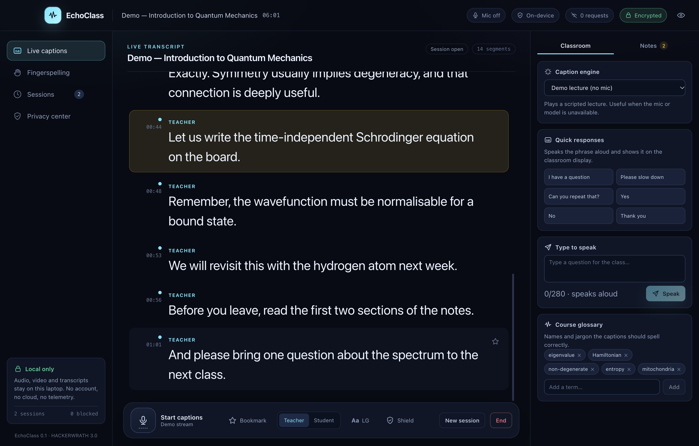
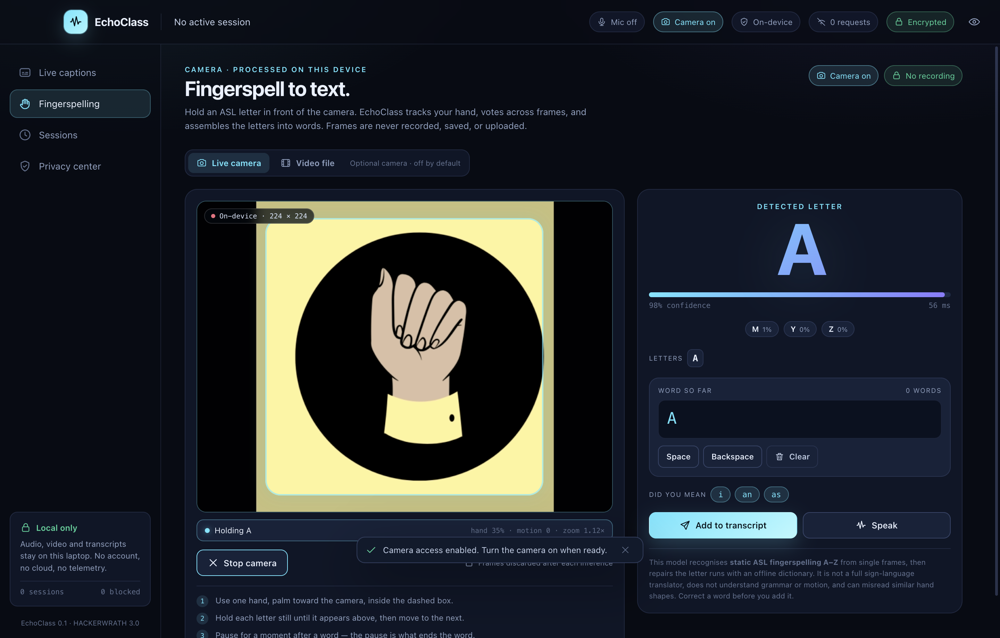
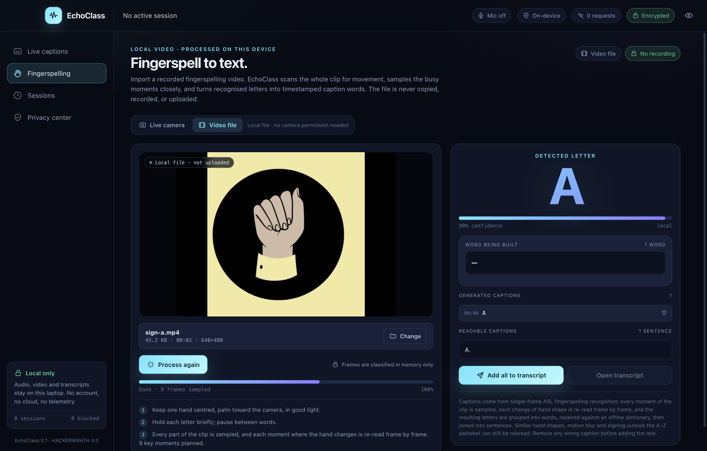
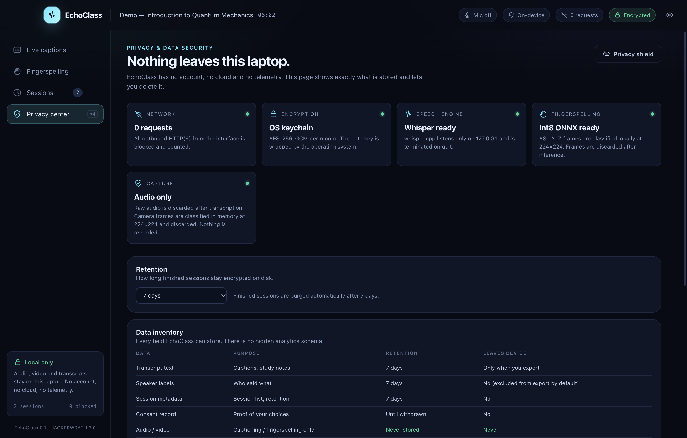
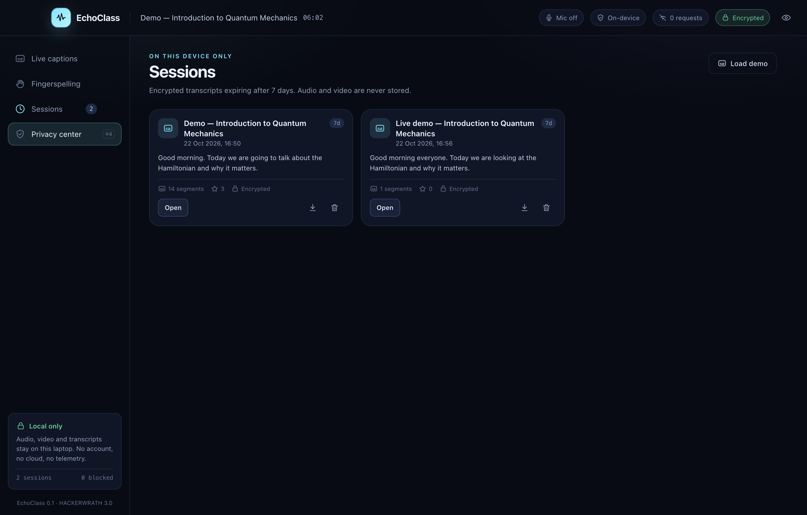
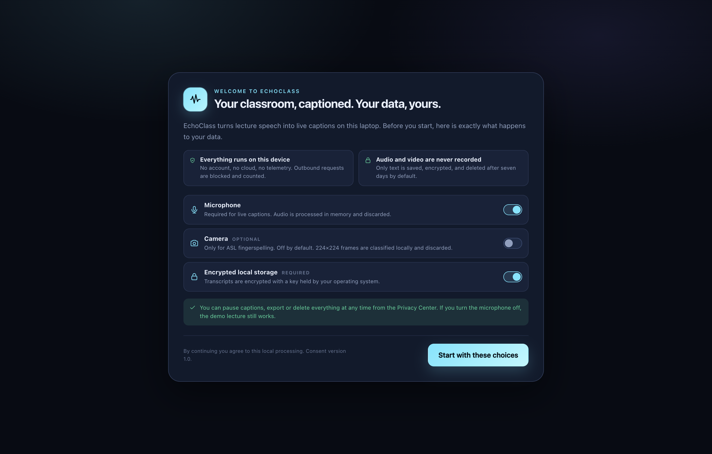

# EchoClass

**A privacy-first desktop classroom accessibility assistant.** Live on-device captions, speaker labels, a course glossary, camera and local-video fingerspelling, non-verbal classroom tools, and an encrypted study transcript — with no account, no cloud, and no recording.

Built for HACKERWRATH 3.0, Problem Statement 04.



## Why this exists

A deaf or hard-of-hearing student in a lecture hall is usually 5–10 seconds behind, using a generic caption app that:

- does not say who is speaking,
- mangles course jargon,
- stops working when campus Wi-Fi does,
- sends audio to a vendor,
- and leaves nothing to revise from.

EchoClass is built around those five failures.

## What works today

- **Live captions** from the microphone through a local `whisper.cpp` server. Audio is streamed as PCM to `127.0.0.1` and never written to disk.
- **Demo lecture mode** so the app is fully demoable without a microphone or model.
- **Camera fingerspelling** using [`prithivMLmods/Alphabet-Sign-Language-Detection`](https://huggingface.co/prithivMLmods/Alphabet-Sign-Language-Detection), converted to int8 ONNX and run locally. 224×224 frames are classified in memory and discarded; nothing is recorded. A–Z static fingerspelling only.
- **Local video import**: choose an MP4, MOV, M4V, WebM or OGV file and the app samples it frame by frame with the same local model. Recognised words become timestamped captions that you can review, remove and add to the encrypted transcript. The video is read in place through an opaque app-token URL with byte-range seeking; it is never copied, uploaded, recorded or used to train anything. Video frames only — the audio track is not transcribed.
- **Speaker labels** (Teacher / Student) via a manual turn switch, with per-segment timestamps.
- **Course glossary** that repairs splits and hyphenation ("eigen value" → "eigenvalue").
- **Bookmarks**, session history, searchable transcript, and Markdown export (speaker names excluded by default).
- **Quick responses + text-to-speech** for non-verbal participation.
- **Privacy Center**: data inventory, encryption status, retention control, export-all, delete-all.
- **Privacy shield** to hide the transcript on a projector.
- **Zero network by default**: every outbound request is blocked and counted in the header.

## Screens

| Live captions | Camera fingerspelling |
|---|---|
|  |  |

| Local video import | Privacy center |
|---|---|
|  |  |

| Sessions | Consent |
|---|---|
|  |  |

## Requirements

- Node.js 20+ (tested on 26)
- `whisper.cpp` for local ASR:
  ```bash
  brew install whisper-cpp        # macOS
  npm run fetch-model             # downloads ggml-tiny.en.bin (~74 MB)
  ```
  On Linux/Windows, point `WHISPER_SERVER` at a `whisper-server` binary.
- macOS, Windows or Linux. macOS is the tested target.
- The converted fingerspelling model lives in `models/sign/`. If it is missing, run the one-time converter described in [models/sign/README.md](models/sign/README.md). The app never downloads it at runtime.

The app runs without Whisper in **Demo mode**. It shows a clear message and offers the switch.

## Run

```bash
npm install
npm run fetch-model
npm run dev
```

First launch shows a consent screen. Microphone and camera are separate choices; the camera is off by default.

## Build

```bash
npm run build      # compile main, preload and renderer
npm run package    # unpacked app in release/
npm run dist       # dmg / nsis / AppImage
```

## Test

```bash
npm run typecheck
npm test
node tests/e2e/smoke.mjs      # UI flow, screenshots, renderer isolation, encrypted store
node tests/e2e/asr.mjs        # real microphone-path permission + local Whisper IPC (macOS)
node tests/e2e/sign.mjs       # fake-camera fingerspelling pipeline, ONNX IPC, transcript insert
node tests/e2e/video.mjs      # local MP4 frame sampling, captions, token revocation
npm run package
node tests/e2e/packaged.mjs   # launches the packaged .app, transcribes speech, runs ONNX
```

## Keyboard shortcuts

| Shortcut | Action |
|---|---|
| `⌘/Ctrl + 1/2/3/4` | Captions / Fingerspelling / Sessions / Privacy |
| `⌘/Ctrl + Shift + M` | Start or pause captions |
| `⌘/Ctrl + Shift + B` | Bookmark the last segment |
| `⌘/Ctrl + Shift + S` | Toggle privacy shield |
| `Esc` | Close shield or dialog |

## Architecture

```
main (trusted)            preload                 renderer (sandboxed)
─────────────────         ─────────               ─────────────────────
window + CSP              contextBridge           React UI + camera/video preview
network guard             narrow, typed API       AudioWorklet-style capture
encrypted store   ←IPC→                           whisper.cpp client
whisper.cpp server                                canvas → 224×224 RGB frames
ONNX Runtime (int8)                               word builder → transcript
local video token protocol                        frame sampler → timestamped captions
export dialogs
```

- **Main process** owns all filesystem access, the OS keychain, the local ASR server, the ONNX classifier, and the network policy.
- **Preload** exposes one narrow method per operation. No `ipcRenderer`, `fs`, `path` or `child_process`.
- **Renderer** has no Node access. `contextIsolation`, `sandbox` and `nodeIntegration: false`.

## Data and storage

Stored in `app.getPath('userData')/data`:

| File | Contents |
|---|---|
| `key.bin` | 32-byte data key, wrapped by the OS keychain (`safeStorage`) |
| `store.bin` | AES-256-GCM encrypted sessions, settings, consent and metadata-only audit log |

Raw audio, video and camera frames are **never persisted**. The camera stream exists only while the Fingerspelling page is visible; one 224×224 RGB frame at a time crosses IPC and is dropped immediately. An imported video is not copied into app storage: the main process serves the user-selected file through an unguessable `echoclass-media://` token with byte-range support, the renderer samples crops into 224×224 frames, and the token is revoked when you leave the page or choose another file. Exports are the only way text leaves the app, and they are written with `0600` permissions.

See [PRIVACY.md](PRIVACY.md) and [SECURITY.md](SECURITY.md).

## Known limits (honest list)

- **English only.** Hinglish code-switching is the next language milestone.
- **No diarization model.** Speaker labels are manual. That is deliberate: a wrong label is worse than a manual toggle.
- **Fingerspelling is not sign-language translation.** The shipped model classifies static ASL hand shapes A–Z. It does not understand motion, grammar, facial expression, ISL, or continuous signing. Similar letters can be confused, so the UI asks you to confirm the built word. Video import holds a letter for two consecutive samples before committing it, which can collapse repeated letters.
- **Video import reads hand shapes, not the soundtrack.** It does not transcribe a video's audio track, generate speaker labels, or understand continuous signing. Supported containers are MP4/M4V/MOV/WebM/OGV up to 2 GB, subject to Chromium's codec support.
- **Sign model is a generated artifact.** `models/sign/model.onnx` is produced once by `scripts/convert-sign-model.py`; it is not committed (83 MB) and is bundled into packaged builds from the local workspace.
- **Single machine.** No LAN student view yet. Multi-device mode would need TLS and room authentication.
- **Small model.** `tiny.en` favours latency over accuracy (it heard “eigenvalues” as “eigenwoles” in our test). The runtime pins the model SHA-256; switching to `base.en` means updating the digest in `src/main/asr.ts` and `scripts/fetch-model.mjs`.
- **Not legal advice.** A real classroom deployment needs institutional review, a student opt-out, and a DPIA.

## 90-second demo

1. Open the app. Point at the header: **0 requests**, **Encrypted**, **Mic off**.
2. Start captions. Read a sentence with jargon ("the Hamiltonian is non-degenerate"). Show the corrected caption and the latency badge.
3. Tap **Student**, ask a question. It is labelled separately.
4. Star a segment. Open **Notes** and show the bookmark.
5. Open **Fingerspelling**, turn the camera on, sign a letter, and add the built word to the transcript. Point out that the camera indicator turns off again on stop. Then choose **Video file**, open a short fingerspelling clip, generate captions, remove a wrong word, and add the rest.
6. End the session. Reopen it from **Sessions**. Export the Markdown.
7. Open **Privacy Center**. Show the data inventory, retention, `Delete all data`.
8. Turn off Wi-Fi. Start a new session. Captions and fingerspelling still work.

## Licence

MIT. Whisper models are MIT (OpenAI); whisper.cpp is MIT. The fingerspelling model is Apache-2.0 (`prithivMLmods/Alphabet-Sign-Language-Detection`).
